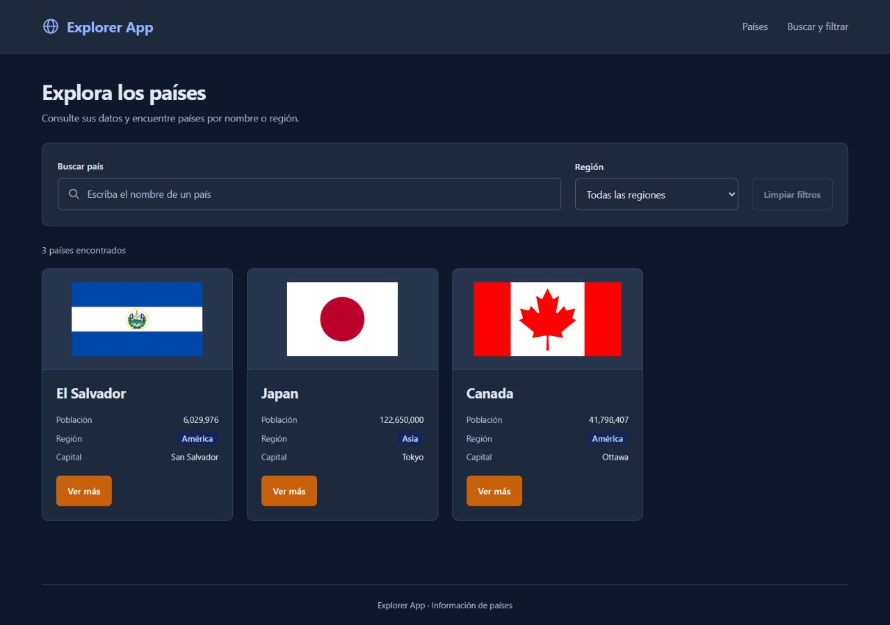

# Explorer App con React — Yonatan Chicas

Proyecto de S24–S27 desarrollado con **React 18, TypeScript, Vite, Tailwind CSS v4 y pnpm**. La interfaz sigue Atomic Design y utiliza los tres registros de demostración del material de clase: **El Salvador, Japan y Canada**.

Incluye búsqueda inmediata por nombre, filtro por región combinado, mensaje sin coincidencias, limpieza de controles y navegación adaptable. El estado compartido permanece en `App.tsx`. No utiliza una API ni React Router en este parcial.

## Instalación y ejecución

Requisitos: Node.js 22.12 o una versión compatible de las ramas 24 o 26, pnpm y Git. La referencia de Node está en `.nvmrc`; `package.json` indica `pnpm@11.25.0` y `pnpm-lock.yaml` fija las dependencias.

Clone el repositorio independiente y entre en su carpeta:

```bash
git clone https://github.com/YonatanC31/explorer-react.git
cd explorer-react
```

Desde esa carpeta, donde está `package.json`, ejecute:

```bash
node -v
pnpm -v
pnpm install --frozen-lockfile
pnpm run dev
```

Abra la dirección que muestre Vite, normalmente `http://127.0.0.1:5174/`, y mantenga la terminal abierta. No abra `index.html` con doble clic. Si el puerto está ocupado, Vite indicará otro. En Windows también puede utilizar `iniciar.cmd`; instala las dependencias si faltan y ejecuta `pnpm run dev`.

```bash
pnpm list react react-dom @types/react @types/react-dom
pnpm run lint
pnpm test
pnpm run build
pnpm run preview
```

`build` comprueba TypeScript y genera `dist/`. `lint` utiliza Oxlint. `preview` permite revisar la compilación, normalmente en `http://127.0.0.1:4174/`. El archivo `.gitignore` excluye `node_modules`, `dist`, el almacén de pnpm, las variables de entorno y los archivos de registro.

## Atomic Design

```text
src/
  components/
    atoms/
      Badge.tsx          Presenta la región recibida.
      Flag.tsx           Presenta la bandera y su respaldo.
      Button.tsx         Botones reutilizables.
      Icon.tsx           Iconos de la interfaz.
      CountryFact.tsx    Etiqueta y valor de un dato.
    molecules/
      CountryCard.tsx    Compone Flag, Badge y los datos del país.
      SearchBar.tsx      Búsqueda controlada con onQueryChange.
      RegionFilter.tsx   Región controlada con onRegionChange.
      Navigation.tsx     Enlaces del menú.
      EmptyState.tsx     Mensaje y acción para restablecer filtros.
    organisms/
      Header.tsx         Título, children, navegación y controles.
      CountryGrid.tsx    Listado de tarjetas generado con map().
  data/countries-demo.ts Los tres registros locales de clase.
  data/regions.ts        Valores exactos y nombres visibles del selector.
  types/country.ts      Interfaces del contrato de países.
  utils/filter.ts       Búsqueda y región combinadas.
  utils/format.ts       Formato de población y capital.
  App.tsx               Estado compartido y callbacks del padre.
  main.tsx              Montaje de React e import de index.css.
  index.css             Tailwind v4, tokens y estilos adaptables.
```

### CountryGrid y CountryCard

`CountryGrid` recibe `countries: Country[]` y `onSelect: (code: string) => void`. Recorre el arreglo con `map()`, entrega cada objeto a `CountryCard` mediante `country` y transmite el mismo callback `onSelect`. Utiliza `country.codes.alpha_2` como `key` estable y única.

`CountryCard` declara una interfaz de props y compone `Flag`, `Badge`, nombre, población y capital. El botón «Ver más» llama a `onSelect(country.codes.alpha_2)`. En esta etapa `handleSelect`, definido en `App`, muestra `SV`, `JP` o `CA` en la consola; no navega a una página de detalle.

Al añadir otro objeto con un código único al arreglo recibido por `CountryGrid`, aparece otra tarjeta sin modificar el componente.

## Estado, children y controles de S27

`App.tsx` conserva `query`, `region` e `isMenuOpen` mediante `useState`. Los resultados y su cantidad se calculan a partir de los registros originales; no se guarda otra copia del arreglo filtrado en estado.

```text
App (query y setQuery)
  → Header (query y onQueryChange)
    → SearchBar (value={query} y onChange tipado)
      → onQueryChange(texto) → setQuery en App

App (region y setRegion)
  → Header (region y onRegionChange)
    → RegionFilter (value={region} y onChange tipado)
      → onRegionChange(valor) → setRegion en App
```

`Header` recibe un título y `children: ReactNode`. App coloca entre `<Header>...</Header>` el párrafo «Consulte sus datos y encuentre países por nombre o región». Header lo muestra y transmite los valores y callbacks a los controles. No guarda una copia local de los filtros.

El menú sigue el mismo principio: `Header` recibe `isMenuOpen`, `onMenuToggle` y `onMenuClose`; el estado permanece en App. Puede cerrarse con su botón, al seleccionar un enlace o con Escape desde la navegación.

La búsqueda es inmediata, no distingue mayúsculas ni espacios exteriores y siempre se combina con la región. Borrar el texto conserva la región; elegir «Todas las regiones» conserva el texto. «Limpiar filtros» y «Restablecer filtros» reinician ambos valores.

## Datos de clase

Los objetos `elSalvador`, `japon` y `canada`, y el arreglo `countriesDemo`, siguen el [repositorio de referencia facilitado en el material](https://github.com/Kcruz080492/explorer-react/blob/main/src/data/countries-demo.ts). Se mantienen los nombres en inglés, los códigos `SV`, `JP`, `CA`, las poblaciones y las capitales de esa muestra. Por eso debe buscar `Japan` para encontrar el registro japonés.

La interfaz conserva `names.common`, `codes.alpha_2`, `flag.url_svg`, `population`, `region` y `capitals`. Las banderas se incluyen en `public/flags/` y solo sus rutas se adaptan para servirlas localmente. La licencia de los datos se conserva en `public/data/LICENSE.txt`. No se realiza ninguna petición `fetch` ni se requiere una clave.

## Verificación de S25–S27

| Búsqueda | Región | Resultado esperado |
| --- | --- | --- |
| Vacía | Todas | El Salvador, Japan y Canada: 3 países. |
| `SAL` | Todas | El Salvador: 1 país. |
| Vacía | América (`Americas`) | El Salvador y Canada: 2 países. |
| Vacía | Asia | Japan: 1 país. |
| `can` | América | Canada: 1 país. |
| `can` | Asia | Mensaje sin coincidencias: 0 países. |
| Vacía | Europa | Mensaje sin coincidencias: 0 países. |
| Limpiar filtros | Todas | Se recuperan los 3 países. |

Compruebe también «Ver más» en la consola, la navegación con teclado y el menú móvil. El grid tiene cuatro columnas desde 1120 px y una en móvil; con los tres registros de clase queda una posición libre en escritorio. No se añade un cuarto país ajeno a la muestra. El modo oscuro responde automáticamente a la preferencia del sistema, sin interruptor adicional.

Las pruebas verifican esos casos, el flujo de callbacks, `children`, los códigos de selección y la reutilización del grid al añadir otro país. Ejecute `pnpm run lint`, `pnpm test` y `pnpm run build` antes de guardar cambios; revise después `git diff` y utilice Conventional Commits.

## Capturas reales

Vista de escritorio, con el modo oscuro automático activo:



- [Vista móvil](./docs/capturas/movil.jpg).
- [Menú móvil abierto](./docs/capturas/menu-movil.jpg).
- [Filtro `can` combinado con América](./docs/capturas/filtro-canada.jpg).
- [Sin coincidencias con `can` y Asia](./docs/capturas/sin-resultados.jpg).

## Preparación del video y entrega

- [Preparar la grabación](./docs/preparar-grabacion.md).
- [Guion de 3 a 5 minutos](./docs/guion-video.md).
- [Respuestas de apoyo de S24–S27](./docs/respuestas-s24-s27.md).
- [Lista de entrega en Canvas](./docs/entrega-canvas.md).

La fecha indicada en la actividad es el **4 de noviembre de 2026**. Debe entregar el enlace de su repositorio y un video de 3 a 5 minutos con escritorio, móvil, filtros combinados, menú, estado y callbacks. El guion y las capturas no sustituyen ese video.

## Repositorio y rama de entrega

- Repositorio público independiente: [YonatanC31/explorer-react](https://github.com/YonatanC31/explorer-react).
- Código completo en [`main`](https://github.com/YonatanC31/explorer-react/tree/main).
- Rama del avance de S24–S27: [`entrega-s24-s27`](https://github.com/YonatanC31/explorer-react/tree/entrega-s24-s27).

La carpeta local y el repositorio React son independientes del proyecto anterior, como indica S24. La [entrega Vanilla TypeScript](https://github.com/YonatanC31/Laboratorio2_DWA/tree/vanilla-typescript-v1.0.0) se conserva en su propio repositorio.

Para consultar y ejecutar la rama del avance:

```bash
git clone --branch entrega-s24-s27 https://github.com/YonatanC31/explorer-react.git
cd explorer-react
pnpm install --frozen-lockfile
pnpm run dev
```
